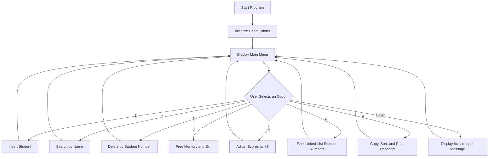

# Student System

A console-based student management system implemented in C++. This project was created as a midterm test and demonstrates the use of linked lists, classes, dynamic memory, operator overloading, searching, deletion, score adjustment, and ranking.

## Project Purpose

The purpose of this project is to provide a simple command-line system for managing student records. It allows users to store student information, search for students, update scores, remove records, display the linked-list structure, and print a ranked transcript.

## Technologies Used

- **C++**
- **Object-oriented programming** with classes and member functions
- **Singly linked list** for storing student records
- **Dynamic memory management** using `new` and `delete`
- **Standard Library** headers:
  - `<iostream>` for console input and output
  - `<string>` for student names
  - `<cstring>`

## Main Features

The system provides an interactive menu with the following functions:

1. **Insert Student Data**
   - Adds a student number, name, programming score, and English score.
   - Prevents duplicate student numbers.
   - Keeps records sorted by student number.

2. **Search Student Data**
   - Searches for students by name.
   - Displays the student number and scores.
   - Reports when a student cannot be found and identifies multiple students with the same name.

3. **Delete Student Data**
   - Deletes a student record by student number.
   - Supports deletion at the beginning or in the middle/end of the linked list.

4. **Adjust Scores**
   - Adds 5 points to both the programming and English scores of a selected student.

5. **Print Linked-List Data**
   - Displays student numbers in linked-list order.

6. **Print Transcript**
   - Calculates each student's total score.
   - Sorts a copied list by total score in descending order.
   - Displays rankings, student information, individual scores, and total scores.

## Installation and Execution

### Prerequisites

Install a C++ compiler such as:

- GCC / G++
- Clang
- MinGW on Windows
- Visual Studio with C++ support

### Clone the Repository

```bash
git clone https://github.com/Athenahhw/Student-System.git
cd Student-System
```

### Compile

The source file is named `minterm` and contains C++ source code. If necessary, rename it to `minterm.cpp`, or compile it directly with a compiler that accepts the file extension:

```bash
g++ -std=c++11 -Wall -Wextra -o student-system minterm.cpp
```

### Run

On macOS or Linux:

```bash
./student-system
```

On Windows:

```bash
student-system.exe
```

Follow the menu prompts to insert, search, delete, adjust, list, or rank student records.

## System Architecture / Flowchart

The application uses a menu-driven architecture. Student records are represented by `STNODE` objects connected through a singly linked list.



### Data Structure Overview

```text
head -> [Student Node] -> [Student Node] -> [Student Node] -> NULL
          |                  |
          |                  +-- student number, name, scores, next pointer
          +-- student number, name, scores, next pointer
```

The original list is maintained in ascending student-number order. When the transcript is printed, the list is copied and sorted by total score so that the original order is preserved.

## App Screen / Demo

This is a command-line application rather than a graphical app. A typical session starts with the following menu:

```text
MENU
(1). Insert Student
(2). Search Student
(3). Delete Student
(4). Adjust Score
(5). Print List Data
(6). Print Transcript
(0). Exit
Please select one
```

Example transcript output:

```text
===== Student Transcript Ranking =====
Rank    Student No.    Name            Programming    English    Total
1       1002           Student B       90             88         178
2       1001           Student A       85             80         165
=========================
```

> The exact output depends on the student records entered during execution.

## My Responsibilities

As the project developer, my responsibilities included:

- Designing the `STNODE` class to represent student records.
- Implementing the singly linked-list structure.
- Creating the interactive menu and program flow.
- Implementing insertion with duplicate-number checking and ordered placement.
- Implementing student search and deletion operations.
- Implementing score adjustment through operator overloading.
- Implementing linked-list copying, memory cleanup, transcript sorting, and ranking.
- Testing the main functions through console input and output.

## Known Limitations

- Student data is stored only in memory and is lost when the program exits.
- The program accepts console input but has limited validation for non-numeric or out-of-range scores.
- Scores are not explicitly restricted to a specific range such as 0–100.
- Students can be searched by name only; searching by student number is not included as a separate feature.
- The user interface is text-based and does not provide a graphical interface.
- The source file does not currently use a standard `.cpp` extension.
- The transcript sorting algorithm is bubble sort, which is inefficient for a large number of students.

## Future Improvements

- Rename the source file to `minterm.cpp` and add a build configuration such as a `Makefile` or CMake project.
- Add input validation and clear error messages for invalid values.
- Save and load student records using a text file, CSV file, or database.
- Add update and editing functions for student names and individual scores.
- Support searches by student number and partial name.
- Replace bubble sort with a more efficient sorting algorithm or an STL container algorithm.
- Improve memory safety by using smart pointers or standard containers such as `std::list` or `std::vector`.
- Add automated tests for insertion, searching, deletion, score adjustment, and ranking.
- Provide a graphical or web-based user interface.
- Add localization support for English and Chinese output.

## Privacy and Security

This project does not require API keys, passwords, authentication credentials, or personal information. Do not add such sensitive data to the source code or repository.

## License

No license has been specified for this repository yet.
